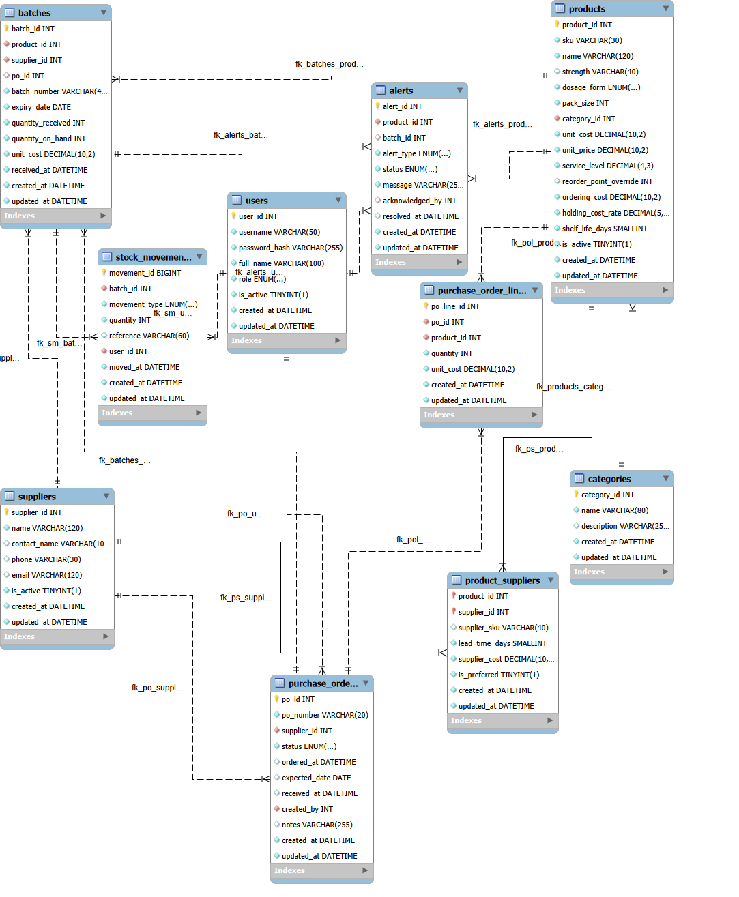

# Pharmaceutical Stock Level Tracker

**BFB321 – Supply Chain Web Application Project**  
**University of Pretoria – 2026**  
**Group 14**

## 1. Project Description

The Pharmaceutical Stock Level Tracker is a web-based inventory management and replenishment decision-support system designed for community pharmacies in South Africa.

The application aims to improve pharmaceutical inventory visibility and support more effective stock management by integrating stock levels, expiry dates, replenishment requirements and demand information into a centralised dashboard.

The project addresses common inventory management challenges, including stockouts, overstocking, medicine expiry and inefficient replenishment decisions.

The application integrates a web-based user interface, a Flask backend, a MySQL database and quantitative supply chain models to support informed inventory management decisions.

## 2. Project Objectives

The application is designed around three main objectives:

1. **Real-Time Inventory Visibility:** Provide a centralised dashboard displaying pharmaceutical stock levels, expiry dates and reorder status.

2. **Safety Stock Alerts and Reorder Prompts:** Identify products that reach or fall below predefined safety-stock thresholds and notify pharmacy staff when replenishment should be considered.

3. **Demand Forecasting:** Analyse historical sales and consumption data to identify demand patterns and support informed replenishment decisions.

## 3. Application Features

The application includes the following functionality:

- Centralised inventory dashboard.
- Product search and filtering.
- Pharmaceutical product and category management.
- Supplier management.
- Batch-level inventory and expiry tracking.
- Stock receipt and dispensing.
- First-Expiry-First-Out (FEFO) stock dispensing.
- Safety stock and reorder point calculations.
- Recommended replenishment quantities.
- Demand forecasting using moving averages and exponential smoothing.
- Inventory alerts and notifications.
- Live supply chain key performance indicators (KPIs).
- REST API integration.
- Database transaction management and input validation.

## 4. Group Members and Task Allocation

| Name and Surname | Student Number | GitHub Username | Task Allocation |
|---|---|---|---|
| Marcus Kruger | u23561310 | MarcusKruger10 | B1 – Data Model & Database Integration |
| Melissa du Plessis | u04467729 | MelissaDP-uni | B2 – Backend & API |
| Rebecca Tejessy | u22570111 | RebeccaTej | B3 – Frontend & Features; B4 – Deployment & Operations |
| Cara Dalporto | u22655809 | CaraDalporto | B5 – Impact, Sustainability & Professionalism; B6 – Team Collaboration & Git Contribution; B7 – Folder Structure & Code Quality |

The project was developed collaboratively using Git and GitHub for version control. Individual contributions and development progress are documented through the repository's commit history.

Repository:
https://github.com/MarcusKruger10/BFB321_group_14

## 5. Technologies Used

| Technology | Purpose |
|---|---|
| HTML | Web application structure |
| CSS | User interface styling and layout |
| JavaScript | Client-side functionality and API integration |
| Python | Backend development and supply chain calculations |
| Flask | Web application framework and REST API |
| MySQL | Relational database management |
| Pytest | Automated application and API testing |
| Git and GitHub | Version control and team collaboration |
| Visual Studio Code | Development environment |

## 6. Installation and Setup Instructions

### 6.1 Requirements

Ensure that the following software is installed:

- Python 3
- pip (Python package manager)
- MySQL Server
- Git
- Visual Studio Code or an equivalent code editor
- A modern web browser, such as Google Chrome or Microsoft Edge

### 6.2 Clone the Repository

Open a terminal and execute:

```bash
git clone https://github.com/MarcusKruger10/BFB321_group_14.git
cd BFB321_group_14
```

Alternatively, clone the repository through Visual Studio Code using the Git: Clone command in the Command Palette (`Ctrl + Shift + P`).

### 6.3 Create a Virtual Environment

Create a Python virtual environment:

```bash
python -m venv .venv
```

Activate the virtual environment.

Windows PowerShell:

```powershell
.venv\Scripts\Activate.ps1
```

macOS or Linux:

```bash
source .venv/bin/activate
```

### 6.4 Install Dependencies

Install the required Python packages:

```bash
python -m pip install -r requirements.txt
```

### 6.5 Configure Environment Variables

Create a local `.env` file using the provided `.env.example` template.

Windows PowerShell:

```powershell
Copy-Item .env.example .env
```

macOS or Linux:

```bash
cp .env.example .env
```

Open the `.env` file and configure the database connection settings according to the local MySQL installation.

Ensure that:

- MySQL Server is running.
- The database credentials are correct.
- The configured MySQL user has the required database permissions.
- The appropriate Flask environment is selected.

The `.env` file contains local configuration information and should not be committed to GitHub.

### 6.6 Initialise the Database

For a new local development or demonstration database, execute:

```bash
python init_db.py
```

This script uses the database schema and demonstration data provided in the `database/` directory.

Do not initialise an existing database containing important records without reviewing the initialisation script and creating a backup.

### 6.7 Run the Application

Start the Flask application:

```bash
python app.py
```

Open the following address in a web browser:

http://127.0.0.1:5000

The application must be accessed through the Flask server to enable communication between the frontend, backend and MySQL database.

Live Server is not required for the final submission.

## 7. Database Design

The application uses a relational MySQL database to store and manage pharmaceutical inventory information.

The database supports the management of products, categories, suppliers, inventory batches, stock movements, demand information and inventory alerts.

### 7.1 Entity Relationship Diagram



*Figure 1: Entity Relationship Diagram of the Pharmaceutical Stock Level Tracker database.*

### 7.2 Database Files

| File | Description |
|---|---|
| `database/schema.sql` | Defines the relational database structure, tables and relationships |
| `database/seed.sql` | Provides demonstration data for application testing |
| `database/erd.png` | Entity Relationship Diagram |
| `init_db.py` | Database initialisation script |
| `db.py` | Database connection and transaction management |

The demonstration dataset is used for academic development and testing purposes. It does not represent verified operational data from an actual pharmacy.

## 8. Application Structure

The application follows a modular architecture that separates the user interface, backend routes, database operations, supply chain models and testing functionality.

```text
BFB321_group_14/
│
├── api/
├── database/
├── docs/
├── models/
├── services/
├── static/
├── templates/
├── tests/
│
├── .env.example
├── .gitignore
├── app.py
├── config.py
├── db.py
├── init_db.py
├── pytest.ini
├── README.md
└── requirements.txt
```

### 8.1 File and Folder Responsibilities

| Folder / File | Description |
|---|---|
| `app.py` | Creates the Flask application, registers the API blueprint and error handlers, and serves the HTML pages |
| `config.py` | Contains environment-specific settings, including DevelopmentConfig, TestingConfig and ProductionConfig |
| `db.py` | Manages MySQL connections, parameterised queries and database transactions with rollback |
| `api/` | Contains REST API routes, input validation and centralised error handling |
| `database/` | Contains the database schema, demonstration data and Entity Relationship Diagram |
| `docs/` | Contains supporting project documentation |
| `models/` | Contains supply chain models for replenishment, demand forecasting, expiry management and inventory access |
| `services/` | Contains database and business operations used by the API |
| `static/` | Contains static frontend resources, including CSS and JavaScript |
| `templates/` | Contains HTML templates for the web application |
| `tests/` | Contains automated application and API tests |
| `init_db.py` | Initialises the database |
| `.env.example` | Provides a template for environment configuration |
| `.gitignore` | Excludes unnecessary and sensitive local files from version control |
| `requirements.txt` | Lists required Python dependencies |
| `pytest.ini` | Contains the Pytest configuration |
| `README.md` | Provides project documentation and installation instructions |

The modular structure supports maintainability, code readability, testing and future system development.

## 9. Supply Chain Models

### 9.1 Safety Stock

Safety stock provides a buffer against uncertainty in demand and replenishment lead times.

The application uses safety stock calculations to support inventory availability and reduce the risk of stockouts.

### 9.2 Reorder Point

The reorder point identifies the inventory level at which replenishment should be considered.

The application evaluates available stock against the calculated or manually configured reorder threshold and identifies products requiring replenishment.

### 9.3 Demand Forecasting

Historical demand information is used to estimate future pharmaceutical consumption.

The application includes moving average and exponential smoothing forecasting methods, together with backtesting functionality to support forecast evaluation.

### 9.4 First-Expiry-First-Out (FEFO)

The FEFO inventory management principle prioritises dispensing pharmaceutical batches according to their expiry dates.

Stock with the nearest expiry date is prioritised to reduce the risk of pharmaceutical wastage.

## 10. REST API

The Flask application exposes a JSON REST API under `/api`.

The API provides communication between the frontend, backend, database and supply chain models.

### 10.1 API Structure

The API blueprint includes:

- `products.py`
- `suppliers.py`
- `stock.py`
- `alerts.py`
- `validators.py`
- `errors.py`

Input validation and centralised error handling support consistent API behaviour.

### 10.2 Endpoints

| Method | Path | Purpose | Success Code |
|---|---|---|---|
| GET | `/api/products` | List products with stock, nearest expiry and reorder status. Query: `page`, `size`, `category`, `status`, `search` | 200 |
| GET | `/api/products/<id>` | Retrieve a product with its safety stock, reorder point and recommended order quantity | 200 |
| POST | `/api/products` | Create a product | 201 |
| PATCH | `/api/products/<id>` | Update product details or reorder threshold | 200 |
| GET | `/api/products/<id>/batches` | Retrieve product batches, nearest expiry first. Query: `include_empty` | 200 |
| GET | `/api/products/<id>/forecast` | Retrieve demand forecasts and backtesting results. Query: `window`, `alpha` | 200 |
| GET | `/api/categories` | Retrieve categories with product counts | 200 |
| GET | `/api/suppliers` | List suppliers. Query: `page`, `size`, `search`, `active` | 200 |
| GET | `/api/suppliers/<id>` | Retrieve a supplier and its associated products | 200 |
| POST | `/api/suppliers` | Create a supplier | 201 |
| PATCH | `/api/suppliers/<id>` | Update supplier details | 200 |
| POST | `/api/stock/receive` | Receive stock and create a batch and receipt movement | 201 |
| POST | `/api/stock/dispense` | Dispense stock using FEFO and update the reorder alert | 200 |
| GET | `/api/alerts` | List alerts. Query: `page`, `size`, `status`, `type` | 200 |
| PATCH | `/api/alerts/<id>` | Acknowledge or resolve an alert | 200 |
| GET | `/api/kpis` | Retrieve live dashboard KPIs | 200 |

### 10.3 Response Format

A successful single-record response:

```json
{
  "data": {
    "product_id": 1,
    "sku": "AMX-500",
    "stock_on_hand": 240,
    "reorder_status": "Sufficient"
  }
}
```

A paginated response:

```json
{
  "data": [],
  "page": 1,
  "size": 20,
  "total": 0,
  "pages": 0
}
```

An error response:

```json
{
  "error": {
    "code": 400,
    "message": "Invalid input",
    "details": {
      "quantity": "must be at least 1"
    }
  }
}
```

### 10.4 HTTP Status Codes

| Status Code | Description |
|---|---|
| 200 | Successful request |
| 201 | Resource successfully created |
| 400 | Invalid input |
| 404 | Resource not found |
| 405 | HTTP method not allowed |
| 409 | Conflict, such as duplicate records or insufficient stock |
| 500 | Unexpected server error |

### 10.5 Request Examples

#### Create a Product

`POST /api/products`

```json
{
  "sku": "LOR-010",
  "name": "Loratadine",
  "strength": "10mg",
  "category_id": 4,
  "unit_cost": 0.75,
  "unit_price": 1.80,
  "pack_size": 10
}
```

Required fields:

- `sku`
- `name`
- `category_id`
- `unit_cost`
- `unit_price`

Optional fields:

- `strength`
- `dosage_form`
- `pack_size`
- `service_level`
- `reorder_point_override`
- `shelf_life_days`

#### Change the Reorder Threshold

`PATCH /api/products/1`

```json
{
  "reorder_point_override": 150
}
```

Send `null` to return to the reorder point calculated by the supply chain model.

#### Receive Stock

`POST /api/stock/receive`

```json
{
  "product_id": 2,
  "supplier_id": 1,
  "batch_number": "LOT-7781",
  "expiry_date": "2028-06-30",
  "quantity": 400,
  "unit_cost": 0.32
}
```

#### Dispense Stock

`POST /api/stock/dispense`

```json
{
  "product_id": 2,
  "quantity": 30,
  "reference": "RX-1001"
}
```

The response includes the batches used and the product's updated stock level and reorder status.

#### Resolve an Alert

`PATCH /api/alerts/3`

```json
{
  "status": "resolved"
}
```

### 10.6 Trying the API

Ensure that the Flask application is running before testing the API.

The following endpoint can be accessed directly through a web browser:

```text
http://127.0.0.1:5000/api/products
```

Example GET request using curl:

```bash
curl "http://127.0.0.1:5000/api/products?status=Reorder%20Needed&size=5"
```

Example POST request using curl in Bash:

```bash
curl -X POST "http://127.0.0.1:5000/api/stock/dispense" \
     -H "Content-Type: application/json" \
     -d '{"product_id": 2, "quantity": 30}'
```

The API can also be tested using an API testing tool such as Postman.

### 10.7 Validation, Error Handling and Logging

- Input validation is performed in `api/validators.py`.
- Errors are handled centrally in `api/errors.py`.
- API errors are returned in a consistent JSON format.
- Database writes are rolled back when transactions fail.
- Parameterised database queries are used to reduce SQL injection risks.
- API requests and failures are logged using Python's `logging` module.
- Unexpected server errors do not expose stack traces through API responses.

## 11. Application Testing

Automated integration tests are included to evaluate API functionality and application behaviour.

The API integration tests are located in:

```text
tests/test_api.py
```

Configure an appropriate test environment and test database before running automated tests. Do not run tests that modify data against a production database.

To execute the API integration tests:

```bash
python -m pytest tests/test_api.py -v
```

To execute the complete available test suite:

```bash
python -m pytest -v
```

Testing is intended to evaluate:

- Product retrieval and management.
- Supplier management.
- Stock receipt and dispensing.
- Demand forecasting.
- Inventory alerts.
- Dashboard KPI retrieval.
- Input validation.
- Error handling.

## 12. Expected Project Impact

The Pharmaceutical Stock Level Tracker is designed to support improvements in pharmaceutical inventory management through:

- Improved inventory visibility.
- Earlier identification of potential stockouts.
- More informed replenishment decisions.
- Reduced risk of pharmaceutical expiry and wastage.
- Improved accessibility of inventory information.
- Reduced dependence on manual stock monitoring.
- Improved consistency in inventory management decisions.

These benefits represent the intended outcomes of the application. Quantitative improvements must be evaluated using controlled testing, demonstration data or clearly documented estimates before being presented as measured results.

## 13. Sustainability and Scalability

The application supports future development through its modular architecture and relational database design.

Potential scalability improvements include:

### 13.1 Multi-Site Inventory Management

The database could be extended to support multiple pharmacy branches, allowing inventory levels, stock movements and replenishment requirements to be managed independently for each location.

### 13.2 User Roles and Access Control

Role-based access control could be introduced or expanded to differentiate the responsibilities and permissions of pharmacists, inventory managers and system administrators.

### 13.3 Database Scalability

The MySQL database could accommodate increasing product and transaction volumes through appropriate indexing, query optimisation and database maintenance.

Pagination within the REST API supports the retrieval of larger datasets without requiring all records to be displayed simultaneously.

### 13.4 Deployment and Hosting

The separation of application configuration, database operations and business logic supports future migration to a production hosting environment.

Production deployment would require appropriate server configuration, secure authentication, HTTPS, database backups and monitoring.

### 13.5 Environmental and Economic Sustainability

Improved expiry management and replenishment planning have the potential to reduce pharmaceutical wastage, unnecessary inventory investment and emergency replenishment requirements.

The FEFO dispensing approach supports the responsible use of existing pharmaceutical stock.

## 14. Current Limitations

The application was developed as an academic supply chain management project.

Current limitations and considerations include:

- Demonstration data is used instead of verified operational pharmacy data.
- Actual operational improvements have not been validated through a live pharmacy implementation.
- Forecasting accuracy depends on the quality and availability of historical demand information.
- Replenishment recommendations depend on the accuracy of inventory and model input parameters.
- Multi-branch deployment and large-scale performance require further evaluation.
- Production deployment requires additional security, reliability and operational assessments.

The application is intended to support inventory management decisions rather than replace professional pharmaceutical judgement.

## 15. Version Control and Team Collaboration

GitHub is used as the central repository for application development and collaboration.

The repository supports:

- Version control.
- Tracking individual contributions.
- Documenting development progress.
- Maintaining a history of application changes.
- Integrating work completed by different group members.
- Supporting code review and future maintenance.

Individual contributions can be reviewed through the GitHub repository's commit history and contributor information.

## 16. Academic Purpose

This application was developed by Group 14 as part of the BFB321 Supply Chain Web Application Project at the University of Pretoria in 2026.

The project demonstrates the practical integration of supply chain management principles, inventory control models, relational databases, backend development and web-based decision-support systems.